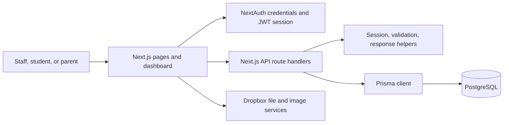

# Habnaj International School Information System

## Purpose

Habnaj International is a web-based school information system. It brings school administration and academic records into one application: staff maintain people and school structure, teachers and administrators enter academic information, and students and parents can access information relevant to them.

This guide describes the system as it exists in the codebase. It is intended for someone evaluating, operating, or learning the application. The sections about features distinguish between database capability and complete user workflows: a model in the database does not necessarily mean that the feature has a finished screen and API for every action.

## At a glance

The application is a Next.js website with two broad areas:
 
1. **Public pages**, including the landing page, contact pages, school news, and photo gallery.
2. **Authenticated dashboards** for super administrators, administrators, teachers, students, and parents.

The browser renders pages and dashboard features. Client-side components call Next.js API routes for data. Those routes validate the session, validate or interpret request data, and read or write records through Prisma. Prisma maps the application's data model to PostgreSQL.



## People and roles

The application stores four kinds of login accounts in separate database models: `Administration`, `Teacher`, `Student`, and `Parent`. The roles used by the application are:

| Role | Typical system responsibilities |
| --- | --- |
| **Super administrator** | Broad system administration and configuration. |
| **Administrator** | Manage school records and academic setup. |
| **Management** | Administrative and academic oversight. |
| **Teacher** | Work with lessons, attendance, students, grades, and traits. |
| **Student** | Access the student dashboard and their academic information. |
| **Parent** | Access information associated with their linked children. |

Administration accounts store their role in the `Roles` enum (`Admin`, `Super`, or `Management`). Teacher, student, and parent roles come from the account model used to authenticate. At sign-in, administrators use email, teachers use email, students use their admission number, and parents use their phone number as the username. All account types use a bcrypt password hash when a password is set.

## System architecture

### Web application

`src/app/` contains the Next.js App Router pages, layouts, and API routes. The public site is composed from landing, news, contact, and gallery pages. Dashboard routes are grouped by role under `src/app/dashboard/` and contain the matching screens for school administration and academic tasks.

The shared dashboard layout provides the navigation shell. Feature components in `src/features/` implement larger areas such as student management, teachers, classes, grading, results, and settings. Reusable controls and display components live in `src/components/`. Client hooks in `src/hooks/` and API helpers in `src/lib/api/` support fetching and updating data from the browser.

### API and business logic

`src/app/api/` contains route handlers for resources such as students, parents, teachers, classes, subjects, terms, gradings, grading policies, lessons, attendance, announcements, events, news, and results. Many handlers use common utilities in `src/lib/utils/api-helpers.ts` to:

- Read the current NextAuth session and optionally check an allowed role list.
- Parse request JSON and validate it with Zod schemas.
- Return JSON success and error responses.
- Check whether a record exists before operating on it.

Some handlers implement more specific business rules directly. For example, the grade endpoint checks that assessment IDs belong to the grading policy and that submitted scores do not exceed assessment maximums. The result endpoint calculates report-card totals, averages, positions, and remarks.

The API routes are server-side code. Dashboard middleware does not replace API authorization: each API handler needs to perform its own authentication and record-access checks.

### Authentication and page protection

`src/lib/auth.ts` configures NextAuth's credentials provider. It looks up the supplied username in the account models, checks that the account is active, and compares the supplied password with the stored bcrypt hash. The resulting JWT contains the user ID (`sub`) and role. The session callback exposes those values to server and client code.

`middleware.ts` allows public pages and requires a token for other matched pages. It redirects users away from role-specific dashboard paths that do not match their session role. API routes are excluded from that page matcher, so they rely on handler-level checks. The dashboard layout also checks for a session in the browser; that is a user-interface guard and is not a substitute for server-side access control.

### Database access

`prisma/schema.prisma` defines the PostgreSQL schema and generates a Prisma client into `src/generated/prisma`. `src/lib/prisma.ts` exports a shared Prisma client, reusing one instance during local development to avoid opening excess database connections during hot reload.

Schema migrations are stored in `prisma/migrations/`. They are the recorded sequence of changes that builds the database structure. Database model types and enums are generated from the Prisma schema.

### File storage

The project includes a Dropbox integration for uploaded files and images. UI components request file uploads and shared links; server utilities use configured Dropbox credentials to obtain API access. A file or image reference is generally stored with the related record as a string or URL rather than as binary data in PostgreSQL.

## Database structure

The database is relational. IDs connect a student to their parent and class, grades to students and subjects, and lessons to teachers, subjects, and classes. The schema also uses enums for values that should come from a known set, such as terms, weekdays, payment status, news status, and student promotion status.

### Accounts and school structure

| Model | What it represents | Main relationships and notes |
| --- | --- | --- |
| `Administration` | Admin, super-admin, and management accounts. | Has a unique email, role, active flag, password hash, profile fields, and notifications. |
| `Teacher` | Teacher profile and account. | Has a unique email, optional unique phone, teaching section, lessons, assignments, tests, classes where they are form master, and subject links. |
| `Parent` | Parent/guardian profile and account. | Has a unique phone, optional unique email, and a one-to-many relationship with students. |
| `Student` | Student profile and account. | Has a unique admission number, optional unique email and phone, a required parent and class, academic records, attendance, payments, assignments, submissions, and notifications. |
| `Class` | A school class or cohort. | Has a unique name, optional capacity, section, optional form-master teacher, and related students, lessons, grades, report cards, events, and assignments. |
| `Subject` | A subject taught at the school. | Links to teachers and to lessons, assignments, tests, assessments, and grades. |

The teacher-to-subject relationship is many-to-many. A teacher can teach several subjects, and a subject can be associated with several teachers. Classes connect to their form master through `formmasterid`; lessons also specify their teacher, subject, and class.

### Academic calendar and teaching

| Model | What it represents |
| --- | --- |
| `Term` | A term within an academic session, including its start/end dates, next-term date, days open, and active/inactive status. |
| `Lesson` | A scheduled lesson with weekday, start/end times, teacher, subject, and class. Its ID is an auto-incrementing integer. |
| `Attendance` | Whether a student was present for a dated lesson. It links one student to one lesson. |
| `Assignment` | An assignment, its text and due date, optional file reference, teacher, class, and subject. It can have submissions and an optional set of assigned students. |
| `Submission` | A student's response to an assignment, with answer, file reference, score, feedback, and timestamps. |
| `Test` | A scheduled test with instructions, duration, maximum score, status, open flag, class, subject, teacher, and term text. |
| `Question` | A test question with JSON options and an answer. |
| `Answer` | A student's test answer record and score. |

### Grading and results

| Model | What it represents | Important relationships or constraints |
| --- | --- | --- |
| `GradingPolicy` | A reusable grading setup, including pass mark and maximum score. | Owns assessments and traits; can be used by gradings. |
| `Assessment` | A named component of a grading policy, with weight and maximum score. | Assessment names are unique within a policy. |
| `Grading` | A grading period for a session and term, with a policy and published flag. | A policy, session, and term combination is unique. |
| `StudentAssessment` | A student's score for one assessment in a subject, class, and grading period. | The student/assessment/subject/class/grading combination is unique. |
| `StudentGrade` | An aggregate subject score, grade, remark, and subject position for a student in a class and grading period. | The student/grading/subject/class combination is unique. It can link to assessments. |
| `Trait` | A behavioral, affective, psychomotor, or cognitive trait attached to a grading policy. | The category is an enum. |
| `StudentTrait` | A student's score and optional remark for a trait in a grading period. | Links the student, grading, and trait. |
| `ReportCard` | A generated summary for one student, class, and grading period. | Stores total, average, class position, general remark, and form-master remark. |
| `StudentPromotion` | A student's movement between classes for a session. | Stores source/target classes, date, status, and optional remark. |

The schema includes indexes on frequently queried grading combinations and unique constraints that prevent duplicate grade rows for the same student and subject within a grading period. These constraints also support safe upsert-style grade entry.

### Finance, communications, and public content

| Model | What it represents |
| --- | --- |
| `PaymentSetup` | Fee setup by session, term, and level, including base fee and whether part payment is allowed. |
| `Payment` | A student's payment record for a session and term, with amount and pending/partial/paid/overdue status. |
| `Event` | A dated school event, optionally associated with a class. |
| `Announcement` | A dated notice, optionally associated with a class. |
| `News` | Public-facing news content with category, draft/published/archived status, image, author, and publication metadata. |
| `Gallery` | Public gallery/media metadata with category, active flag, and display order. |
| `Notification` | A typed message that can be linked to an administrator, teacher, parent, or student. |

The payment tables are part of the schema; their presence alone should not be taken as evidence that online payment processing or a complete payment workflow is implemented.

### Main relationship map

```mermaid
erDiagram
    PARENT ||--o{ STUDENT : has
    CLASS ||--o{ STUDENT : enrolls
    TEACHER ||--o{ LESSON : teaches
    SUBJECT ||--o{ LESSON : covers
    CLASS ||--o{ LESSON : schedules
    LESSON ||--o{ ATTENDANCE : records
    STUDENT ||--o{ ATTENDANCE : receives
    GRADING_POLICY ||--o{ ASSESSMENT : defines
    GRADING_POLICY ||--o{ GRADING : configures
    STUDENT ||--o{ STUDENT_ASSESSMENT : earns
    ASSESSMENT ||--o{ STUDENT_ASSESSMENT : scored_as
    STUDENT ||--o{ STUDENT_GRADE : receives
    SUBJECT ||--o{ STUDENT_GRADE : for_subject
    GRADING ||--o{ STUDENT_GRADE : during_period
    STUDENT ||--o{ REPORT_CARD : summarized_on
    GRADING ||--o{ REPORT_CARD : reports
```

## How people use the system

### 1. A person signs in

The user opens the sign-in page and supplies the username format for their account type and password. NextAuth checks the matching account and its active status, verifies the password hash, then creates a JWT-backed session with the user's ID and role. The user is directed to their role's dashboard. Public site pages do not require a session.

### 2. Staff set up the school

An authorized administrator creates or maintains parent and student records, teachers, classes, subjects, terms, and grading policies. Students are connected to a parent and class. Teachers can be connected to subjects and classes, and lessons tie teachers, subjects, and classes together. The term record supplies the calendar context used by the academic year and grading periods.

### 3. Teachers record teaching activity

Lessons provide the class/subject/teacher schedule. Attendance records attach a date and present/absent value to a student and lesson. Assignment and test models provide a structure for learning activities, questions, responses, and submissions. Availability of each action in the interface depends on the implemented page and API routes.

### 4. Staff enter assessment scores

An administrator configures a grading policy and its assessments, then creates a grading period for a session and term. Score entry sends a group of students and their assessment scores to the grade API. The handler checks that the grading period and assessments exist, confirms the assessments belong to that grading policy, checks score limits, then saves assessment rows and aggregate subject grades in a transaction. After saving, it recalculates subject positions for the affected class, subject, and grading period.

### 5. Staff generate report cards

An authorized staff member requests report-card generation for a grading period, optionally limited to a class. The results handler loads students in the selected classes, gathers grades and prior-term averages when relevant, computes totals, averages, positions, and remarks, then writes report-card records. The current logic also includes third-term behavior for promotion remarks in primary and nursery sections. The results API then serves report-card information to permitted dashboards, including student and parent views subject to its implemented checks.

### 6. Users view school information

Dashboards fetch information from the corresponding API routes. Teachers work with school and academic records; parents and students have routes and views for their associated students and results. Public pages use the news and gallery content for visitors. Profile and security screens use account APIs, including the password-change route.

## Key implementation conventions

- Prisma models use `cuid()` identifiers for most entities; lessons, attendance, events, and announcements use integer IDs.
- Passwords are stored as bcrypt hashes, not plain text.
- Request schemas live under `src/lib/schemas/` and `src/lib/validation.ts`.
- Common API helpers live in `src/lib/utils/api-helpers.ts`; error handling is also defined in `src/lib/errors.ts`.
- The generated Prisma client is in `src/generated/prisma/`; edit `prisma/schema.prisma` and create migrations for schema changes rather than editing generated files.
- Client-side code generally calls the application's `/api/...` endpoints. Database access belongs in server-side code.

## Operational notes and current boundaries

- Configure PostgreSQL through `DATABASE_URL`; Dropbox-backed file flows need the Dropbox credentials expected by the server integration. Authentication also depends on the deployment's NextAuth configuration.
- Apply checked-in migrations when preparing a database. The repository also contains a seed script; inspect its effects before using it with any database containing data.
- Authorization is not one global policy layer: dashboard middleware protects page navigation, while API handlers enforce their own session and resource checks. Record-level restrictions should be reviewed per handler when adding or exposing an endpoint.
- Some models represent workflows whose full lifecycle may not yet be available through the user interface. Check both the relevant page and API route before assuming a feature is operational end to end.

## Source map

| Location | Purpose |
| --- | --- |
| `src/app/` | Public pages, role dashboards, and API route handlers. |
| `src/features/` | Larger page and dashboard feature components. |
| `src/components/` | Shared UI, navigation, charts, calendars, and upload controls. |
| `src/hooks/` | Client hooks for fetching and mutating application data. |
| `src/lib/auth.ts` | NextAuth credentials provider and session callbacks. |
| `src/lib/api/` | Client-side API functions. |
| `src/lib/utils/api-helpers.ts` | Session, validation, response, and resource helpers for APIs. |
| `src/lib/prisma.ts` | Shared Prisma client instance. |
| `prisma/schema.prisma` | Database models, relationships, and enums. |
| `prisma/migrations/` | Versioned database migrations. |
